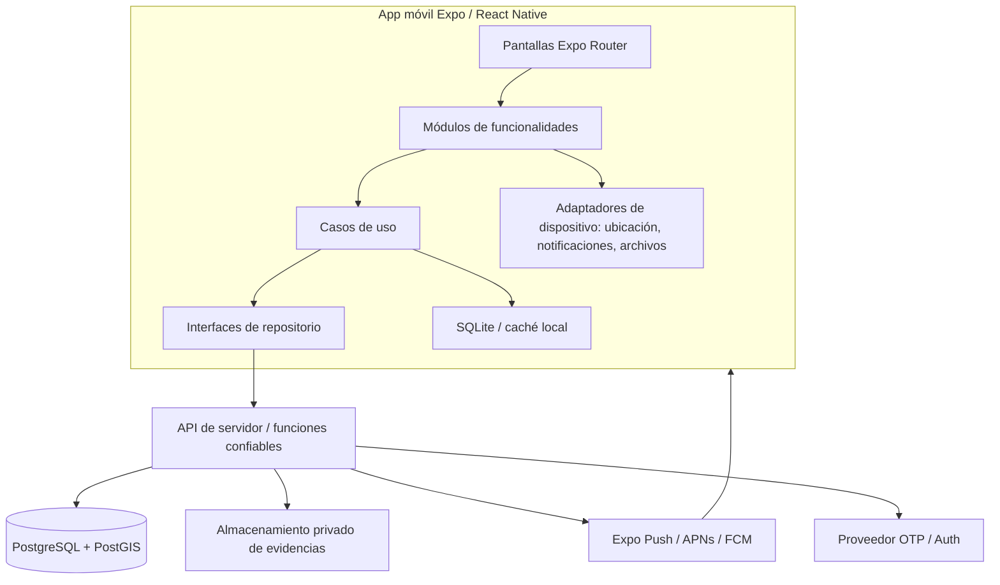

# Arquitectura recomendada — Mi Barrio

**Estado:** propuesta para orientar el desarrollo del MVP  
**Base revisada:** requisitos funcionales y no funcionales RF01–RF23/RNF01–RNF15, prototipo HTML y modelo físico PostgreSQL compartidos por el equipo.

## 1. Resumen ejecutivo

Mi Barrio debe construirse como una aplicación móvil multiplataforma con **Expo + React Native + Expo Router**, respaldada por una API y una base **PostgreSQL con PostGIS**. Como la base del proyecto ya está alojada en Render, se recomienda desplegar ahí también una API Node.js independiente y conectarla mediante `DATABASE_URL` privado. La app móvil solo conoce la URL HTTPS de la API; nunca recibe credenciales PostgreSQL.

La app se organiza por módulos de negocio y capas: presentación, aplicación/casos de uso, dominio y adaptadores de infraestructura. El cliente nunca debe conectarse con credenciales privilegiadas ni decidir reglas de confianza, moderación, proximidad o SOS. Esas decisiones se aplican en funciones de servidor y políticas de base de datos.

El modo offline del MVP debe cubrir lectura de protocolos guardados y una cola local de acciones no críticas. El SOS por Bluetooth/Wi-Fi Direct es una capacidad nativa adicional, con riesgo técnico y de plataforma; se debe investigar y validar en una fase separada. No debe prometerse como función disponible hasta que exista un prototipo probado en dispositivos reales.

## 2. Alcance funcional organizado por dominios

| Dominio | Requisitos | Responsabilidades principales |
|---|---|---|
| Identidad y confianza | RF17–RF19, RNF08, RNF12–RNF15 | OTP, perfil, niveles, evidencia de residencia, avales, controles antiabuso |
| Barrio y geografía | RF02, RF23, RNF09 | Cuadrantes, pertenencia, búsquedas cercanas y minimización de coordenadas |
| Servicios locales | RF01, RF03–RF04 | Catálogo, publicación, búsqueda, visto bueno y contacto |
| Economía colaborativa | RF05–RF07 | Intercambios, herramientas y compras grupales |
| Emergencias | RF08–RF10, RNF05–RNF07, RNF10–RNF11, RF22 | SOS, brigadas, contactos, estado de crisis y protocolos esenciales |
| Aprendizaje | RF11–RF12 | Tutoriales, contenido multimedia y descarga para uso sin conexión |
| Notificaciones | RF13–RF16 | Preferencias, avisos cotidianos, interacciones y alertas críticas |
| Confianza y moderación | RF20–RF22 | Reportes, umbral de ocultamiento, revisión y avisos sobre contenido no confirmado |

## 3. Vista lógica



### Decisiones de arquitectura

1. **Monolito modular en servidor para el MVP.** Una API y una base transaccional son suficientes; microservicios añadirían operación y costo sin resolver una necesidad actual.
2. **Cliente delgado y API como autoridad.** El cliente presenta opciones y valida entradas para UX; la autorización y las reglas finales viven en el servidor y en un rol SQL con privilegios mínimos.
3. **PostGIS como fuente de verdad geográfica.** Filtrar por geocerca/cuadrante y distancia se resuelve en SQL con índices espaciales, no descargando ubicaciones al móvil.
4. **Repositorios por dominio.** Las pantallas usan casos de uso y tipos propios; las llamadas HTTP, consultas PostgreSQL, almacenamiento y push quedan en adaptadores.
5. **Sin promesas de entrega absoluta para push.** APNs/FCM/Expo y el sistema operativo controlan la entrega, especialmente en ahorro de energía o No molestar. Mantener acceso visible a teléfonos de emergencia y un estado claro de envío/confirmación.

## 4. Arquitectura de la app

Mantener `src/app/` exclusivamente para rutas Expo Router. Código de negocio fuera de esa carpeta. Estructura objetivo gradual:

```text
src/
  app/                         # rutas, layouts y guards de navegación
    (auth)/
    (tabs)/
    emergency.tsx
  features/
    auth/ services/ community/ swaps/ tools/ group-purchases/
    emergency/ tutorials/ notifications/ moderation/ profile/
    <dominio>/
      screens/ components/ hooks/ application/ domain/ data/
  shared/
    ui/ theme/ validation/ errors/ types/
  infrastructure/
    api/ database/ storage/ notifications/ location/ offline/
```

Cada dominio debe exponer casos de uso pequeños (por ejemplo, `SearchNearbyServices`, `PublishSwap`, `SendSosAlert`) y contratos de repositorio. No se deben compartir componentes con lógica de negocio acoplada a una pantalla.

**Navegación inicial:** `(auth)` para registro/OTP; `(tabs)` para Inicio, Oficios, Comunidad, Aprender y Perfil; `emergency` como ruta de máxima prioridad que oculta navegación cotidiana. Conservar un acceso SOS persistente y operable con lector de pantalla. Los guards son conveniencia UX; no sustituyen la autorización de servidor.

## 5. Backend y límites de confianza

### Recomendación para MVP

- **API en Render:** servicio Node.js con Express y `pg`, separado del cliente Expo. Conectar desde un servicio de Render con la URL interna de la base en la misma región; usar URL externa con TLS requerido solo para desarrollo fuera de Render.
- **Base Render:** conservar PostgreSQL/PostGIS existente. Aplicar migraciones versionadas, limitar el usuario SQL de runtime a los permisos requeridos y no exponer el puerto ni credenciales al móvil.
- **Push:** enviar desde servidor a Expo Push Service inicialmente, guardar tickets/receipts y tratar los fallos/reintentos. Para escala o capacidades específicas, migrar el envío del servidor a APNs/FCM directamente.
- **SMS OTP:** verificar costo, cobertura local y límites antes de cerrar proveedor. No guardar OTP propio en la app.
- **Configuración:** `DATABASE_URL`, proveedor SMS y secretos solo en variables de entorno del servidor. `EXPO_PUBLIC_API_URL` contiene exclusivamente la URL HTTPS pública de la API.

### Operaciones que deben ejecutarse en servidor

- `search_nearby_services`, `search_nearby_swaps`: filtro de radio, cuadrante y estado publicable.
- `submit_residency_evidence`, `review_residency_evidence`, `grant_tier`: flujo de verificación con permisos separados.
- `create_sos_alert`, `cancel_sos_alert`, `resolve_sos_alert`: límites de frecuencia, cálculo de destinatarios, registro de auditoría y despacho de notificaciones.
- `cast_vouch`, `cast_visto_bueno`: elegibilidad por nivel, barrio y unicidad.
- `report_content`, `moderate_content`: conteo concurrente, ocultamiento y trazabilidad.
- `join_group_purchase`, `request_tool`: transacciones que mantienen cupos y estados consistentes.

## 6. Modelo de datos y ajustes requeridos

El esquema entregado es una buena base conceptual y ya usa PostGIS. Antes de adoptarlo en producción, convertirlo en migraciones ordenadas y revisar estos puntos:

1. **Roles y verificación.** Separar `tier` de estados de verificación; añadir historial de decisiones, quién revisó y motivo. El ascenso a nivel 3 no debe ser una actualización directa desde cliente.
2. **Ubicación privada.** No exponer `users.exact_location` en vistas públicas ni respuestas generales. Preferir geocodificación a cuadrante en operaciones normales; para SOS usar ubicación precisa solo con consentimiento explícito, acceso acotado y retención definida.
3. **Dispositivo.** No basar suspensiones en IMEI o identificadores de hardware: no están disponibles de forma uniforme en iOS/Android y crean riesgos de privacidad. Usar identificadores aleatorios de instalación, señales de integridad disponibles y apelación/revisión; nunca tratar una señal como prueba única.
4. **Reportes polimórficos.** La referencia `(target_type, target_content_id)` no garantiza integridad referencial. Considerar tabla común `community_content` con subtipos o tablas de reportes específicas. El trigger actual no oculta alertas SOS y su lógica de umbral debe ejecutarse atómicamente para evitar carreras.
5. **Notificaciones.** Añadir tabla de eventos/outbox, entregas por dispositivo, estado/timestamp de envío y preferencias. Evitar llamar a push dentro de la transacción de negocio.
6. **Conversaciones.** RF15 menciona mensajes directos, pero falta un modelo explícito para conversaciones, mensajes, bloqueo y controles antiabuso. Definir el alcance de contacto del MVP; si hay chat, añadir entidades y políticas antes de construirlo.
7. **Servicios/productos.** RF01 incluye productos locales; el esquema solo modela servicios. Agregar catálogo de comercios/productos o dejar ese alcance explícitamente para una etapa posterior.
8. **Calificaciones.** RF03 habla de recomendaciones y calificaciones, mientras el SQL solo mantiene un contador de visto bueno. Definir si será un aval binario o una calificación con reglas antiabuso; no mezclar conceptos.
9. **Compras grupales y herramientas.** Aplicar transacciones y restricciones para no exceder cupos, impedir solicitudes duplicadas/conflictos y registrar cambios de estado.
10. **Borrado y retención.** Evitar `ON DELETE CASCADE` indiscriminado para auditoría, reportes y emergencias. Definir conservación, anonimización y borrado de documentos aprobados/rechazados.
11. **Esquema/migraciones.** Reemplazar UUID extensiones por generadores soportados por la versión elegida de PostgreSQL, declarar constraints/checks para estados y añadir índices por claves foráneas y consultas frecuentes. `duration_minutes` debería ser entero, no texto.

### Datos de referencia para una primera versión

Conservar las entidades entregadas (`neighborhood_quadrants`, `users`, `local_services`, `neighborhood_swaps`, `shared_tools`, `group_purchases`, `neighborhood_brigades`, `sos_alerts`, `community_tutorials`, `community_reports`) y añadir por migración las entidades de sesiones/dispositivos push, eventos de notificación, auditoría de verificación, revisión de moderación y conversación si se confirma chat.

## 7. Flujos críticos

### Registro y confianza

1. El usuario valida su teléfono con OTP.
2. Servidor crea nivel 1 y asigna el barrio/cuadrante solo según un flujo verificable.
3. Evidencia de residencia se carga a bucket privado con URL temporal; no se almacena una URL pública.
4. Servicio autorizado revisa; se registra decisión y se elimina o anonimiza evidencia según política.
5. Nivel 3 requiere identidad validada y tres avales válidos; cada aval se comprueba por barrio, estado y duplicidad.

### SOS

1. Confirmación accesible para reducir activaciones accidentales; botón de cancelación/falsa alarma con trazabilidad.
2. Cliente obtiene ubicación solo tras permiso/acción explícita; envía ubicación y precisión al endpoint protegido.
3. Servidor valida usuario, límites, zona y duplicados; persiste alerta y crea evento de salida en una transacción.
4. Proceso de despacho selecciona destinatarios por cuadrante/radio, envía push de prioridad apropiada y guarda resultados.
5. Cliente muestra enviado, pendiente o no confirmado. Se conservan números de emergencia visibles aunque no haya red.

La notificación del sistema no puede prometerse como garantizada, en menos de dos segundos, con DND activo o con la app terminada. SOS fuera de línea requiere canal local real y no se resuelve solo con push ni con una cola que espera conectividad.

### Moderación

Validar que cada usuario solo reporte una vez el mismo contenido. Un procedimiento transaccional bloquea/serializa el conteo por contenido y cambia a `hidden_in_review` al cruzar el umbral. Registrar quién/modo de resolución y permitir restauración tras revisión.

## 8. Privacidad y seguridad

- Rol SQL de mínimo privilegio; validar autorización para usuario anónimo, nivel 1, nivel 2, nivel 3 y moderador en cada endpoint.
- Ubicación exacta, teléfono y documentos nunca aparecen en consultas públicas. Compartir ubicación precisa en SOS solo según consentimiento y durante tiempo limitado.
- Cifrado en tránsito y en reposo del proveedor; evidencias en almacenamiento privado con acceso temporal. AES-256 debe verificarse en la configuración del proveedor y documentarse, no asumirse.
- Límites de OTP, SOS, publicaciones, reportes y avales por cuenta, instalación y ventana temporal. CAPTCHA o controles adicionales ante abuso.
- Auditoría para accesos administrativos, verificación, cambios de nivel, moderación y resolución de emergencia.
- Política de retención y eliminación para coordenadas, comprobantes, tokens push y logs. No guardar el contenido sensible en logs o analítica.
- Evitar datos de contacto públicos hasta que el usuario decida iniciar contacto; validar enlaces y texto contra contenido malicioso.
- Revisar obligaciones locales de privacidad, protección de datos, seguridad pública y uso de alertas antes de un lanzamiento real.

## 9. Offline, resiliencia y rendimiento

- **Primera etapa:** cachear protocolos oficiales, datos mínimos de brigadas y recursos de emergencia; mostrar claramente fecha de última actualización. Permitir operaciones no críticas en cola con idempotency key y sincronización/reconciliación al recuperar conexión.
- **SOS online:** timeout corto, reintento idempotente y confirmación de recepción del servidor; nunca indicar “avisamos” solo porque se pulsó el botón.
- **Malla:** spike técnico separado con BLE/Wi-Fi Direct, permisos, consumo, retransmisión, autenticación de paquetes y protección contra repetición. Definir soporte por OS y pruebas de campo antes de integrarlo.
- Paginación/carga incremental, miniaturas y límites de tamaño para multimedia; consultas de cercanía en servidor y payloads mínimos.
- Medir inicio, latencia de búsquedas, fallos de OTP, confirmación SOS y consumo en background. La app debe operar con permisos denegados usando alternativa manual y mensajes comprensibles.

## 10. Fases de construcción

| Fase | Entregables | Requisitos objetivo |
|---|---|---|
| 0. Decisiones y base | Confirmar alcance chat/productos/calificación; migraciones; ambientes; permisos SQL; contratos API; datos semilla | Reduce ambigüedades del SQL y del prototipo |
| 1. MVP demostrable | OTP, perfil/cuadrante, catálogo/búsqueda, publicar servicios e intercambios, visto bueno, tutoriales, modo emergencia visual, directorio y contactos | RF01–RF05, RF08–RF12, RF17–RF19 parcial |
| 2. Interacción y confianza | Herramientas, compras, solicitudes/contacto, push cotidiano, reportes y revisión, evidencia de domicilio | RF06–RF07, RF14–RF21, RF23 |
| 3. Operación de emergencias | SOS conectado con destinatarios, brigadas verificadas, auditoría, telemetría, simulacros y guardias operativas | RF09–RF10, RF13, calidad y seguridad |
| 4. Offline avanzado | Cache/sync endurecido; prototipo de malla local y validación en dispositivos; desarrollar solo si pasa criterios de aceptación | RNF05–RNF07, RNF11 |

El límite de 48 horas (RNF01) corresponde a un MVP demostrable con datos semilla y alcance recortado; no es compatible con implementar y validar simultáneamente SMS, moderación operativa, push crítico garantizado, revisión de documentos y malla Bluetooth de producción.

## 11. Criterios de aceptación arquitectónicos

- Un usuario de nivel 1 no puede publicar ni votar aunque modifique el cliente.
- Ningún endpoint público puede devolver teléfono o coordenada exacta de terceros.
- Búsquedas cercanas devuelven solo contenido activo y elegible para el cuadrante/radio solicitado.
- Tres reportes independientes y válidos producen un único cambio de estado consistente y auditable.
- Un evento de SOS queda registrado aunque falle el proveedor de push; el fallo se reintenta y se refleja al emisor.
- Un protocolo guardado se abre en modo avión y muestra cuándo fue actualizado.
- Todos los cambios de esquema se aplican desde migraciones versionadas en un entorno limpio.

## 12. Siguiente paso recomendado

Antes de convertir el prototipo en pantallas conectadas, acordar tres decisiones de producto: (1) si mensajes directos y productos locales forman parte del MVP; (2) si el visto bueno es aval binario o calificación; y (3) qué alcance real tendrá SOS sin Internet. Después, conectar la API Node de Render con la base existente, verificar PostGIS, implementar identidad y geografía como cimientos, y conectar un módulo vertical completo de servicios de extremo a extremo.

## Referencias técnicas

- Proyecto actual: Expo SDK 58, Expo Router y React Native 0.88; revisar siempre documentación versionada antes de incorporar APIs o módulos nativos.
- [Referencia de Expo SDK 58](https://docs.expo.dev/versions/v58.0.0/)
- [Índice de documentación Expo para agentes](https://docs.expo.dev/llms.txt)
